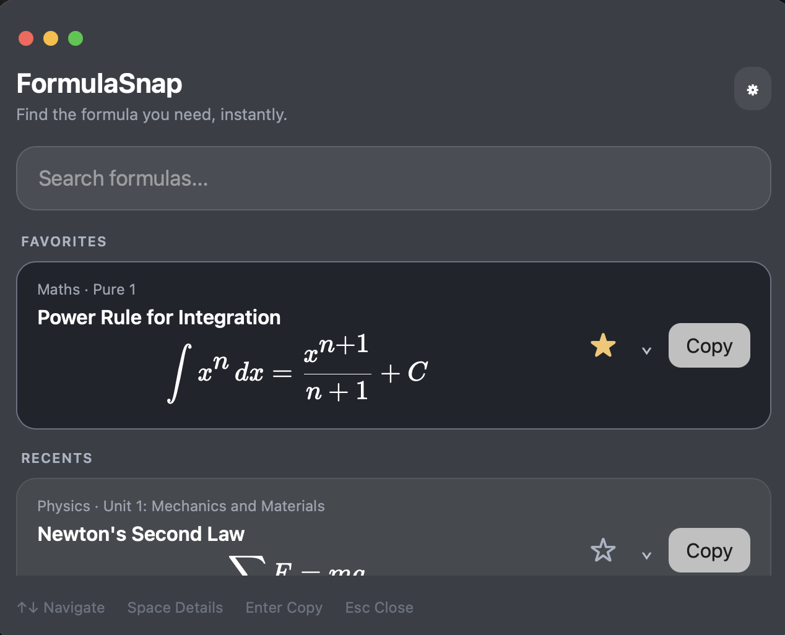
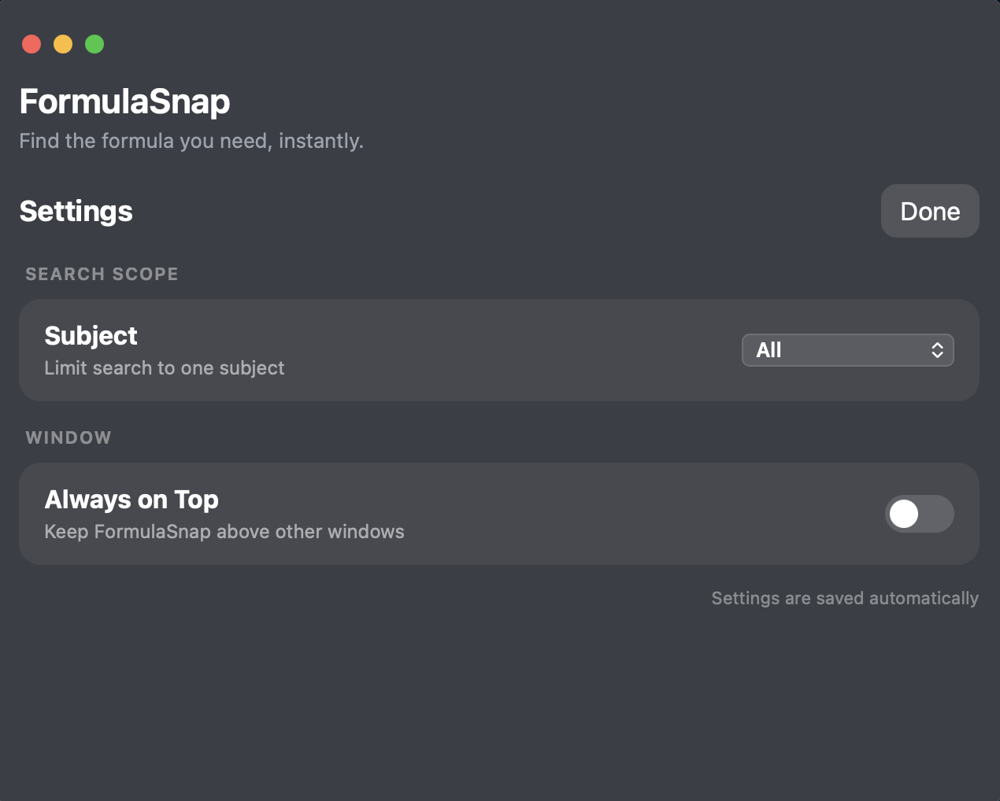
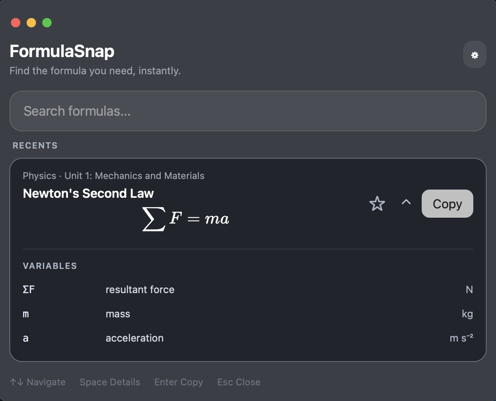
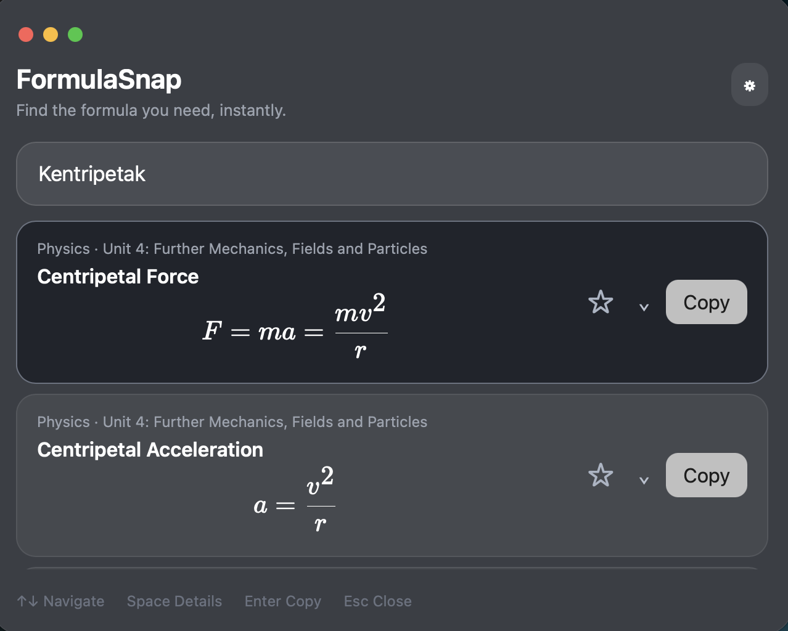

# FormulaSnap

## Live browser demo

Try [FormulaSnap in your browser](https://zhrsidd.github.io/FormulaSnap/).

The browser demo uses the same formula library, fuzzy search, KaTeX rendering,
subject/topic filters, scrollable results, keyboard navigation, expanded details,
Favorites and Recents. Preferences and history stay in localStorage in that
browser (separate from the desktop app). Clipboard copying works over HTTPS or
localhost; the browser may ask for clipboard permission.

Native window controls, Always on Top and the global shortcut are desktop-only
and hidden or disabled in the browser. Enter copies without hiding the page;
Escape still dismisses Settings. The native Tauri build retains its behavior.

### Develop and preview

```sh
npm ci
npm run dev          # Browser development at http://localhost:1420
npm run build:web    # GitHub Pages assets in dist-web/
npm run preview:web  # Open the displayed URL with /FormulaSnap/ appended
```

Desktop commands remain `npm run tauri dev` and `npm run tauri build`.
The default build still writes to `dist/` with base `/`; the web build uses
`/FormulaSnap/` and a separate directory so it cannot overwrite native assets.

### Enable GitHub Pages once

1. Commit and push these changes to `main` in `zhrsidd/FormulaSnap`.
2. In the repository's **Settings → Pages → Build and deployment**, choose
   **GitHub Actions** as the Source. Enable Actions if they are disabled.
3. In **Actions → Deploy FormulaSnap to GitHub Pages**, choose **Run workflow**
   on `main` if the first push ran before Pages was enabled.
4. Wait for both build and deploy to succeed, then open the live demo above.
   If the `github-pages` environment requires approval, approve the deployment.

Subsequent pushes to `main` deploy automatically. No personal access token,
custom domain, or `gh-pages` branch is needed.


A fast, lightweight macOS formula search utility for students.

FormulaSnap lets you instantly search Maths and Physics formulas from anywhere on your Mac using a global keyboard shortcut. Search by formula name, topic, variable, unit, or related terms, then copy the formula without interrupting your workflow.



## ✨ Features

- ⚡ Open FormulaSnap from anywhere with `⌘ ⇧ Y`
- 🔎 Fast fuzzy formula search
- 📐 Maths and Physics formula library
- 🧮 Proper mathematical notation using KaTeX
- ⌨️ Keyboard-first navigation
- 📋 Press Enter to instantly copy a formula
- ⭐ Save frequently used formulas as Favorites
- 🕘 Quickly access recently copied formulas
- 📖 Expand formulas to view variables, units, and additional notes
- 🎯 Filter formulas by subject and topic
- 🪟 Optional Always on Top mode
- 💾 Favorites, recents, filters, and settings are stored locally
- 🔄 Signed automatic desktop updates from GitHub Releases
- 🚫 Offline formula search with no AI required



## 🚀 How It Works

Press:

`⌘ ⇧ Y`

from anywhere on macOS to bring up FormulaSnap.

Start typing to search the formula library. FormulaSnap searches across formula names, aliases, topics, variables, units, and other metadata.



### Keyboard Controls

| Key | Action |
| --- | --- |
| `⌘ ⇧ Y` | Open FormulaSnap |
| `↑` / `↓` | Navigate results |
| `Space` | Expand/collapse formula details |
| `Enter` | Copy selected formula |
| `Esc` | Close/hide FormulaSnap |

## 🔍 Search

FormulaSnap uses fuzzy searching, so you don't need to remember the exact name of a formula.

For example, searches such as:

```text
kinetic energy
acceleration
SUVAT
electric field
quadratic
standard deviation
```

can be used to quickly find relevant formulas.



## 📚 Formula Library

FormulaSnap contains formulas covering Edexcel International A Level Mathematics and Physics, plus a General physics collection for common calculations beyond the formula sheet.

### Physics

- General — work done, power, energy, efficiency, speed, acceleration, pressure, circuits, and other everyday relationships

- Unit 1 — Mechanics and Materials
- Unit 2 — Waves and Electricity
- Unit 4 — Further Mechanics, Fields and Particles
- Unit 5 — Thermodynamics, Radiation, Oscillations and Cosmology

### Mathematics

- Pure Mathematics 1
- Pure Mathematics 2
- Pure Mathematics 3
- Pure Mathematics 4
- Mechanics 1
- Mechanics 2
- Statistics 1
- Statistics 2
- Statistics 3

### Further Mathematics

- Further Pure 1, Further Pure 2 and Further Pure 3 (Pearson FP1–FP3)
- Decision 1: the Pearson booklet supplies no required formulae; the topic explains this

The library includes 146 additional equation cards from the [Pearson formula booklet](https://qualifications.pearson.com/content/dam/pdf/International%20Advanced%20Level/Mathematics/2018/Specification-and-Sample-Assessment/IAL-Mathematics-Formula-Book.pdf), with printed page references in Notes. See [coverage and exclusions](docs/pearson-formula-coverage.md). Numerical lookup tables and M3 are excluded from this expansion.

Formula entries can include:

- Formula name
- Mathematical expression
- Search aliases
- Variables
- Units
- Topic
- Subject
- Additional notes

## 🛠 Built With

FormulaSnap is built using:

- **React** — interface
- **TypeScript** — frontend logic
- **Tauri 2** — desktop application framework
- **Rust** — native application functionality
- **Fuse.js** — fuzzy searching
- **KaTeX** — mathematical equation rendering

The formula library is stored locally, meaning searching does not require an internet connection.

## 💻 Running FormulaSnap Locally

### Requirements

You'll need:

- Node.js
- npm
- Rust
- Tauri's macOS prerequisites

Clone the repository:

```bash
git clone https://github.com/zhrsidd/FormulaSnap.git
cd FormulaSnap
```

Install the dependencies:

```bash
npm install
```

Start FormulaSnap in development mode:

```bash
npm run tauri dev
```

## Automatic desktop updates

Every push to `main` runs `.github/workflows/release.yml`, builds a universal macOS
app for Apple Silicon and Intel, and publishes a signed GitHub Release with
`latest.json`. The app checks five seconds after launch and every four hours,
downloads and installs available updates automatically, then offers **Restart now**.
Settings also includes **Check for updates**. Offline checks leave searching usable.

Existing 1.0.0 installations need one manual replacement with an updater-enabled
build. After that, updates come from GitHub Releases. The browser demo continues
to update through GitHub Pages.

The updater public key is in `src-tauri/tauri.conf.json`. The matching private key
is stored in the repository Actions secret `TAURI_SIGNING_PRIVATE_KEY`; keep a
secure backup at `~/.tauri/formulasnap-updater.key`. Never commit the private key.
Update signatures follow [Tauri's updater documentation](https://v2.tauri.app/plugin/updater/).
macOS builds use ad-hoc app signing; updater signatures are separate from Apple
Developer ID signing and notarization.

Release versions are derived from the base version in `tauri.conf.json`, adding
`GITHUB_RUN_NUMBER` to its patch number (base `1.1.0`, run 42 → `1.1.42`). No manual
version bump is needed per push. Increase the base minor or major version for a
new release series; do not reset the workflow run counter or lower the base.
A release stays a draft until its build and upload finish successfully.

To build a signed update locally:

```sh
TAURI_SIGNING_PRIVATE_KEY="$HOME/.tauri/formulasnap-updater.key" \
TAURI_SIGNING_PRIVATE_KEY_PASSWORD='' npm run tauri build
```

## 📦 Building

To create a production build:

```bash
npm run tauri build
```

Tauri will generate the macOS application and installer under:

```text
src-tauri/target/release/bundle/
```

The generated `.app` can be found under `macos/`, while the `.dmg` installer is generated under `dmg/`.

## 🔒 Privacy

FormulaSnap is designed to work locally.

Formula searches, favorites, recent formulas, and settings do not need to be sent to an external server.

There is no AI model running in the application and no internet connection is required to search the formula library.

## 🎯 Why I Built FormulaSnap

When studying Maths and Physics, finding a specific formula can be surprisingly disruptive. Formula sheets are useful, but locating the exact equation you need often means opening another document, scrolling through pages, or searching online.

FormulaSnap was built to make that process almost instantaneous.

The goal is simple:

> **Shortcut → search → formula → copy.**

FormulaSnap stays out of the way until you need it.

## 🗺️ Future Ideas

Possible future improvements include:

- More subjects and exam boards
- User-created custom formulas
- Editable formula collections
- Additional keyboard shortcuts
- Improved formula discovery
- Windows support

## 🧑‍💻 Development

FormulaSnap was created as part of Hack Club's Stardance.

AI tools were used during development to assist with tasks including structuring formula data, debugging, and parts of the Tauri/Rust setup. The application itself does not use AI at runtime.

## ⚠️ Disclaimer

FormulaSnap is an independent study tool and is not affiliated with, endorsed by, or an official product of Pearson Edexcel.

Formula data should always be checked against the official specification and formula sheets for your course.

## 📄 License

FormulaSnap is open source and available under the [MIT License](LICENSE).